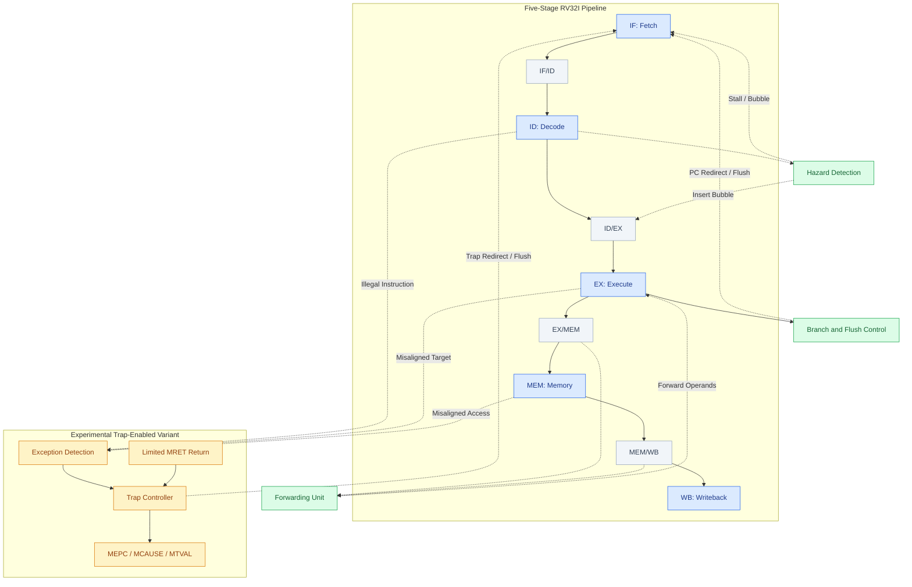

# RV32I RISC-V Processor

### 32-bit CPU Design & Verification in Verilog HDL

[](https://github.com/abdulazizalmodawi/RV32I-RISC-V-Processor-v2/actions/workflows/verilog-tests.yml)

**727 Passed Checks | 43 Testbenches | 5-Stage Pipeline**

---

## Overview

How does a computer processor actually work?

This project explores that question by designing and testing a 32-bit RISC-V processor using Verilog HDL.

It includes three implementations:

- **Single-Cycle CPU:** Executes an instruction through the complete datapath in one clock cycle.
- **Five-Stage Pipelined CPU:** Overlaps instruction execution across five stages.
- **Experimental Trap-Enabled Pipeline:** Demonstrates selected exception handling and limited MRET/CSR functionality.

The goal is to explore processor architecture through practical hardware design, simulation, and verification.

---

## How It Works

The processor fetches instructions, decodes them, executes operations, accesses memory when needed, and writes results back to registers.

The pipelined version divides this process into five stages:

| Stage | Name | Purpose |
|---|---|---|
| IF | Instruction Fetch | Fetch the next instruction |
| ID | Instruction Decode | Decode instructions and read registers |
| EX | Execute | Perform calculations and evaluate branches |
| MEM | Memory Access | Read or write data memory |
| WB | Writeback | Write results to registers |

Multiple instructions can progress through different pipeline stages during the same clock cycle.

---

## Processor Architecture Diagram

The diagram below illustrates the five-stage pipeline, hazard handling, forwarding, and the separate experimental trap-handling functionality.



**Diagram Notes:**

- Solid arrows represent the conceptual pipeline data flow.
- Dashed arrows represent control, forwarding, or exception-related signals.
- The experimental trap-handling block represents a separate processor variant.
- This diagram is conceptual rather than a complete circuit schematic.

---

## Key Features

- **32-bit RISC-V datapath**
- **32 general-purpose registers**, including hardwired x0
- **Single-cycle and pipelined CPU architectures**
- **Arithmetic, logic, shifts, and comparisons**
- **Byte, halfword, and word memory operations**
- **Conditional branches, JAL, and JALR**
- **Data forwarding**
- **Load-use hazard detection**
- **Pipeline stalls, bubbles, and flushing**
- **Experimental synchronous exception handling**
- **Limited MRET and MEPC update support**
- **Automated verification with GitHub Actions**

---

## Verification Results

The processor was verified using self-checking Verilog testbenches and Icarus Verilog.

| Verification Suite | Testbenches | Passed Checks |
|---|---:|---:|
| Single-Cycle CPU | 21 | 373 |
| Baseline Pipeline and Independent Modules | 17 | 291 |
| Experimental Trap Integration | 5 | 63 |
| **Total** | **43** | **727** |

All **727 directed checks** passed in recorded verification runs.

### Experimental Exception Verification

| Test | Passed Checks |
|---|---:|
| Trap Pipeline Integration | 20 |
| Exception Priority | 12 |
| MRET / Trap Return | 9 |
| LHU Alignment | 5 |
| Precise Exception Side Effects | 17 |
| **Total** | **63** |

These tests cover selected exception conditions, pipeline priority, trap return, and instruction side effects.

**Important:** Passing directed tests does not establish complete RV32I or privileged-ISA compliance.

---

## Technologies

- Verilog HDL
- RISC-V RV32I
- Icarus Verilog
- GitHub Actions
- Git and GitHub
- EDA Playground

---

## Project Structure

```text
RV32I-RISC-V-Processor-v2/
├── rtl/                  Single-cycle CPU modules
├── tb/                   Single-cycle testbenches
├── pipeline/             Pipeline and experimental RTL
│   └── tb/               Pipeline testbenches
├── docs/                 Engineering documentation
├── .github/workflows/    Automated verification
├── run_tests.bat         Single-cycle regression
├── run_pipeline_tests.bat
└── README.md
```

---

## Running the Tests

### Requirements

Install Icarus Verilog and ensure `iverilog` and `vvp` are available in the system PATH.

### Single-Cycle Tests

On Windows, from the repository root:

```bat
run_tests.bat
```

### Baseline Pipeline Tests

```bat
run_pipeline_tests.bat
```

### Experimental Trap Tests

The experimental integration tests are included in GitHub Actions:

`.github/workflows/verilog-tests.yml`

The workflow automatically compiles and executes the documented verification suites.

---

## Design Limitations

This is a hardware engineering development project intended for experimentation and technical learning.

Current limitations include:

- Complete RV32I architectural compliance has not been established.
- FENCE uses simplified behavior.
- ECALL and EBREAK architectural trap handling is incomplete.
- Privileged CSR functionality is limited.
- The trap-enabled processor is a separate experimental implementation.
- Precise exception behavior has not been exhaustively verified.
- FPGA implementation and timing closure have not been demonstrated.

---

## Engineering Documentation

For detailed technical information:

- [Architecture](docs/architecture.md)
- [Instruction Set](docs/instruction-set.md)
- [Verification Plan](docs/verification-plan.md)
- [Requirements](docs/requirements.md)
- [Development Progress](docs/progress-log.md)

---

## Reference

[RISC-V RV32I Base Integer Instruction Set Specification](https://docs.riscv.org/reference/isa/unpriv/rv32.html)

---

## Author

**Abdulaziz Al-Modawi Al-Qahtani**

Computer Engineering | Digital Systems | Processor Architecture

*Designed, implemented, and verified as a hardware engineering development project.*
