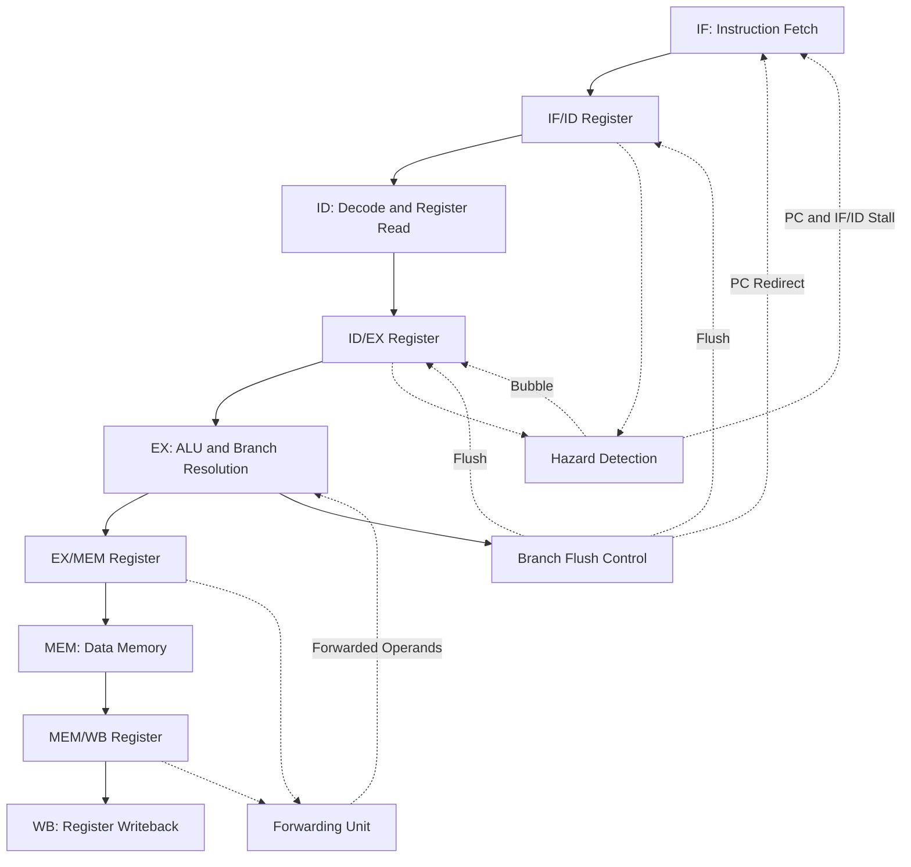

# RV32I RISC-V Processor — Architecture Documentation

**Project:** RV32I RISC-V Processor  
**RTL Language:** Verilog HDL  
**Target ISA:** RISC-V RV32I  
**Data Width:** 32 bits  
**Verification:** Icarus Verilog / EDA Playground  
**Status:** Implemented and tested — continued development

---

## 1. Project Overview

This project explores the design, implementation, and verification
of a 32-bit RISC-V processor using Verilog HDL.

Two processor architectures have been implemented:

1. **Single-Cycle Processor**
2. **Five-Stage Pipelined Processor**

The single-cycle design establishes the core instruction datapath,
while the pipelined implementation extends the architecture with
pipeline registers, forwarding, hazard detection, stalls, and
control-flow flushing.

The project also includes independently tested experimental modules
for exception detection and simplified trap control.

Full RV32I architectural compliance has not been established.

---

## 2. Processor Configuration

| Parameter | Configuration |
|---|---|
| Instruction Set Target | RV32I |
| Data Width (XLEN) | 32 bits |
| Instruction Width | 32 bits |
| General-Purpose Registers | 32 × 32-bit |
| Register x0 | Hardwired to zero |
| Reset PC | 0x00000000 |
| Instruction Alignment | 4 bytes |
| Byte Ordering | Little-endian |
| Instruction Memory | 256 words (default) |
| Data Memory | 1024 bytes (default) |
| Memory Organization | Separate instruction and data memories |
| RTL | Verilog HDL |
| Simulation | Icarus Verilog |

The memory implementations are simulation-oriented models with
combinational reads and clocked data-memory writes.

---

## 3. Single-Cycle Processor

### 3.1 Architecture

The single-cycle processor executes the complete datapath of
one instruction within a single clock cycle.

Its primary modules are:

- Program Counter
- Instruction Memory
- Register File
- Control Unit
- ALU Control
- Arithmetic Logic Unit
- Immediate Generator
- Branch Control
- Next-PC Logic
- Data Memory
- Processor Top-Level

### 3.2 Instruction Execution

The datapath performs the following operations:

1. Fetch the instruction using the Program Counter.
2. Decode the instruction and generate control signals.
3. Read source operands from the Register File.
4. Generate an immediate value when required.
5. Perform arithmetic, comparison, or address calculation.
6. Access Data Memory for loads and stores.
7. Select the appropriate writeback result.
8. Update the architectural registers and Program Counter.

The clock period must accommodate the longest combinational
path through the processor.

### 3.3 Control Flow

Sequential execution normally advances the PC by four bytes.

Conditional branches and jumps calculate alternative addresses
using the instruction PC, immediate offset, and/or source register.

JALR clears bit zero of its computed target.

The existing core validates selected encodings and instruction
target alignment. It does not implement a complete architectural
exception and trap mechanism.

---

## 4. Five-Stage Pipelined Processor

The pipelined implementation separates instruction processing
into five stages.

| Stage | Name | Responsibility |
|---|---|---|
| IF | Instruction Fetch | Fetch instruction and advance PC |
| ID | Instruction Decode | Decode instruction and read registers |
| EX | Execute | ALU, address calculation, branch resolution |
| MEM | Memory Access | Load and store data |
| WB | Writeback | Write results to destination registers |

Pipeline registers preserve the data and control information
associated with each in-flight instruction.

### 4.1 Pipeline Architecture Diagram



This is a conceptual pipeline diagram, not a gate-level
schematic or timing-accurate implementation diagram.

### 4.2 Instruction Fetch (IF)

Instruction Memory provides the instruction corresponding to
the current PC.

The fetch logic normally advances the PC by four bytes.

When a valid branch or jump is resolved in EX, the PC is
redirected to the calculated target.

Instruction Memory provides a validity signal for aligned,
in-range fetch addresses.

### 4.3 Instruction Decode (ID)

The Decode stage performs:

- Opcode and instruction-field extraction.
- Register File reads.
- Immediate generation.
- ALU operation selection.
- Main control-signal generation.
- Selected instruction encoding checks.

The IF/ID validity register tracks whether the fetched
instruction should enter the execution pipeline.

A WB-to-ID bypass is included for selected register
read/write timing dependencies.

### 4.4 Execute (EX)

The Execute stage performs:

- Arithmetic and logical operations.
- Signed and unsigned comparisons.
- Load/store address calculation.
- Branch condition evaluation.
- JAL and JALR target calculation.
- Forwarded operand selection.

Branch conditions are evaluated using forwarded source
operands where required.

### 4.5 Memory Access (MEM)

The Memory stage supports:

- LB, LH, LW
- LBU, LHU
- SB, SH, SW

The memory model checks supported access encodings,
address bounds, and natural alignment.

Invalid accesses are suppressed in the existing
implementation rather than raising complete
architectural traps.

### 4.6 Writeback (WB)

The Writeback stage selects the value written to the
destination register.

| WB Selection | Data Source |
|---|---|
| 00 | ALU Result |
| 01 | Memory Read Data |
| 10 | PC + 4 |
| 11 | Immediate Value |

Register writes are gated by pipeline validity and
write-enable signals.

Writes to register x0 are ignored.

---

## 5. Pipeline Hazard Handling

### 5.1 Data Forwarding

The forwarding unit resolves supported read-after-write
dependencies using results from later pipeline stages.

Forwarding selection:

| Control | Data Source |
|---|---|
| 00 | Original ID/EX Operand |
| 01 | MEM/WB Writeback Data |
| 10 | Available EX/MEM Result |
| 11 | Reserved |

The most recent available result receives priority.

EX/MEM load results are not forwarded before their
memory data becomes available.

The integrated datapath selects the appropriate forwarded
value, including relevant writeback sources.

### 5.2 Load-Use Hazard Detection

An immediate dependency on a LOAD result requires a stall.

The hazard detection logic:

1. Holds the PC.
2. Holds the IF/ID registers.
3. Flushes ID/EX to insert a bubble.
4. Allows the older LOAD instruction to progress.

Source-register usage is determined according to
the decoded instruction type.

### 5.3 Control Hazards

Branches and jumps are resolved in EX.

When a valid control transfer changes execution flow:

1. The PC is redirected.
2. IF/ID is flushed.
3. ID/EX receives a bubble.
4. Wrong-path instructions are prevented from committing.

The control logic gives a valid PC redirect priority
over an ordinary load-use stall.

### 5.4 Pipeline Validity

Pipeline validity signals distinguish active instructions
from invalid entries and inserted bubbles.

Write enables are combined with validity checks to
prevent supported invalid instructions and flushed
operations from updating architectural state.

---

## 6. Instruction Support

The processor implements tested subsets of the RV32I
base integer instruction set.

### Arithmetic and Logic

- ADD, SUB
- AND, OR, XOR
- SLL, SRL, SRA
- SLT, SLTU
- Supported immediate arithmetic and logical operations

### Load and Store

- LB, LH, LW
- LBU, LHU
- SB, SH, SW

### Branch and Jump

- BEQ, BNE
- BLT, BGE
- BLTU, BGEU
- JAL, JALR

### Upper Immediate

- LUI
- AUIPC

### System and Ordering Limitations

- FENCE is modeled as a simplified NOP.
- ECALL and EBREAK do not have complete trap handling.
- Full privileged architecture support is not implemented.

Instruction-level details are documented in
[instruction-set.md](instruction-set.md).

---

## 7. Exception and Trap Development

Experimental modules have been implemented and
independently tested.

### 7.1 Exception Detection Unit

The exception detection module supports selected
exception conditions:

| Exception | Cause Code |
|---|---|
| Instruction Address Misaligned | 0 |
| Illegal Instruction | 2 |
| Load Address Misaligned | 4 |
| Store Address Misaligned | 6 |

For simultaneous detected events in different stages,
the module prioritizes older instructions:

**MEM > EX > ID**

The module provides exception cause, faulting instruction
address, and associated fault information.

### 7.2 Trap Controller

The simplified trap controller records:

- `mepc`: Faulting instruction address
- `mcause`: Exception cause
- `mtval`: Associated fault value
- `trap_active`: Trap activity flag

It also provides trap redirection and flush requests.

The configured default trap vector is `0x00000100`.

### 7.3 Exception-Aware Pipeline Register

`ex_mem_trap_reg.v` extends the EX/MEM data path with
the original instruction PC so that faulting instruction
addresses can be reported from MEM.

### 7.4 Integration Status

**The exception and trap modules have passed independent
tests but are not integrated into the verified pipelined core.**

The experimental trap-top variant is under development.

The current modules do not constitute a complete
RISC-V privileged architecture, CSR subsystem,
or precise exception implementation.

---

## 8. Verification Strategy

Verification uses self-checking Verilog testbenches
executed with Icarus Verilog.

The project includes:

- Individual hardware module tests.
- Processor-level instruction execution tests.
- Pipeline integration tests.
- Forwarding and hazard diagnostics.
- Memory and alignment tests.
- Control and safety tests.
- Independent exception and trap module tests.

### 8.1 Recorded Verification Results

| Verification Category | Passed Checks |
|---|---:|
| Single-Cycle Processor | 373 |
| Pipeline Unit Tests | 104 |
| Pipeline Integration | 16 |
| Advanced Pipeline Hazards | 29 |
| Memory and Edge Cases | 33 |
| Pipeline Control and Safety | 26 |
| Load-Forwarding Diagnostic | 13 |
| Stall and Flush Diagnostic | 16 |
| Exception Detection Unit | 18 |
| Trap Controller | 20 |
| EX/MEM Trap Register | 16 |
| **Total** | **664** |

All reported checks passed in their corresponding
recorded simulation runs.

These results represent directed checks, not
664 independent verification programs.

They do not constitute exhaustive formal verification
or RV32I architectural compliance certification.

### 8.2 Verification Organization

Single-cycle testbenches are stored in:

`tb/`

Pipeline and experimental module testbenches
are stored in:

`pipeline/tb/`

The verification plan is maintained in
[verification-plan.md](verification-plan.md).

---

## 9. Repository Organization

```text
RV32I-RISC-V-Processor-v2/
├── rtl/
│   └── Single-cycle processor RTL modules
├── tb/
│   └── Single-cycle testbenches
├── pipeline/
│   ├── processor_pipeline_top.v
│   ├── processor_pipeline_trap_top.v
│   ├── exception_detection_unit.v
│   ├── trap_controller.v
│   ├── ex_mem_trap_reg.v
│   └── tb/
│       └── Pipeline and module testbenches
├── docs/
│   ├── architecture.md
│   ├── instruction-set.md
│   ├── progress-log.md
│   ├── requirements.md
│   └── verification-plan.md
└── README.md
```

The pipeline implementation reuses selected modules
from the single-cycle RTL directory.

---

## 10. Design Limitations

The following limitations remain:

1. Full RV32I compliance has not been established.
2. Full architectural exception and trap handling
   is not integrated into the pipelined processor.
3. Complete privileged CSR support is not implemented.
4. ECALL and EBREAK handling is incomplete.
5. FENCE does not implement full ordering semantics.
6. Memory is modeled primarily for functional simulation.
7. Formal verification and FPGA timing closure
   have not been demonstrated.
8. Verification coverage is directed rather than exhaustive.

These limitations are explicitly documented to distinguish
implemented functionality from future development.

---

## 11. Future Development

Potential improvements include:

- Precise exception and trap integration.
- Privileged CSR support.
- Architectural trap return handling.
- Additional instruction and hazard corner-case testing.
- Automated simulation regression scripts.
- More detailed datapath and control-flow diagrams.
- FPGA synthesis and timing analysis.

---

## 12. Engineering Documentation

Additional project documents include:

- [Requirements](requirements.md)
- [Instruction Set](instruction-set.md)
- [Verification Plan](verification-plan.md)
- [Development Progress](progress-log.md)

## References

- [RISC-V RV32I Base Integer ISA Specification](https://docs.riscv.org/reference/isa/unpriv/rv32.html)

---

**Document Status:** Updated to reflect the implemented
and independently verified project components.

**Project:** RV32I RISC-V Processor  
**Author:** Abdulaziz Al-Modawi Al-Qahtani
