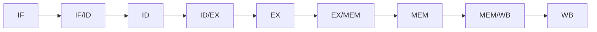

# RV32I RISC-V Processor — Architecture Documentation

**Project:** RV32I-RISC-V-Processor-v2  
**RTL Language:** Verilog HDL  
**Target ISA:** RV32I  
**Document Version:** 1.0  
**Last Updated:** November 24, 2026  
**Status:** Implemented and Directed-Tested

## 1. Project Overview

This project implements and verifies a 32-bit RISC-V processor using Verilog HDL.

The repository contains:

1. A single-cycle processor
2. A five-stage pipelined processor
3. A separate experimental trap-enabled pipeline

Verification uses self-checking Verilog testbenches and Icarus Verilog.

The reported regression results comprise 727 directed checks across 43 testbenches.

Full RV32I and privileged-architecture compliance has not been established.

## 2. Processor Configuration

| Parameter | Configuration |
|---|---|
| Target ISA | RV32I |
| Data Width | 32 bits |
| Instruction Width | 32 bits |
| Registers | 32 x 32-bit |
| x0 | Hardwired zero |
| Reset PC | 0x00000000 |
| Instruction Alignment | 4 bytes |
| Byte Ordering | Little-endian |
| Instruction Memory | 256 words by default |
| Data Memory | 1024 bytes by default |
| Memory Organization | Separate instruction and data memories |
| Language | Verilog HDL |
| Simulator | Icarus Verilog |

The memory implementations are primarily functional simulation models.

## 3. Single-Cycle Processor

The single-cycle processor completes the instruction datapath within one clock cycle.

Major modules include:

- Program Counter
- Instruction Memory
- Register File
- Control Unit
- ALU and ALU Control
- Immediate Generator
- Branch Control
- Next-PC Logic
- Data Memory
- Writeback Logic

The design supports selected RV32I instruction decoding, execution, memory operations, branches, and jumps.

Invalid or unsupported operations are handled according to the implemented baseline control logic.

A complete architectural exception subsystem is not present in this baseline design.

## 4. Five-Stage Pipeline

The baseline pipelined processor uses the following stages:

| Stage | Function |
|---|---|
| IF | Instruction Fetch |
| ID | Instruction Decode and Register Read |
| EX | Execution and Branch Evaluation |
| MEM | Data Memory Access |
| WB | Register Writeback |

Pipeline registers preserve instruction operands, destinations, control signals, and validity information between stages.

### 4.1 Pipeline Diagram



This diagram represents the conceptual stage sequence, not a timing-accurate circuit implementation.

### 4.2 Data Hazards

The processor uses forwarding for supported register dependencies.

Load-use hazards are handled by:

1. Holding the PC
2. Holding IF/ID
3. Inserting an ID/EX bubble
4. Allowing the older load to continue

### 4.3 Control Hazards

Branches and jumps are resolved in the execution stage.

Supported taken control transfers redirect the PC and flush younger wrong-path instructions.

### 4.4 Pipeline Validity

Instruction validity information prevents selected bubbles and invalid instructions from producing architectural side effects.

## 5. Experimental Trap-Enabled Pipeline

The experimental implementation is maintained separately from the baseline pipeline.

**Top-Level Module:**

`pipeline/processor_pipeline_trap_top.v`

Major supporting modules include:

- `exception_detection_unit.v`
- `trap_controller.v`
- `ex_mem_trap_reg.v`

### 5.1 Exception Detection

The experimental implementation detects selected:

- Illegal instructions
- Misaligned instruction targets
- Misaligned load addresses
- Misaligned store addresses

### 5.2 Exception Priority

For simultaneous detected exceptions in different pipeline stages:

**MEM > EX > ID**

This prioritizes the older detected instruction.

### 5.3 Trap Context

The trap controller records:

- `mepc`: Faulting instruction address
- `mcause`: Exception cause
- `mtval`: Associated fault information
- `trap_active`: Experimental trap state

The default trap vector is `0x00000100`.

### 5.4 Experimental MRET

The experimental implementation returns to the saved `mepc` value.

A limited CSR write interface allows the trap handler to update MEPC before returning.

This behavior is intentionally restricted and does not constitute complete privileged ISA support.

### 5.5 Side-Effect Verification

A dedicated testbench exercises selected cases involving:

- Older instructions before an exception
- Younger instructions after an exception
- Architectural register or memory side effects
- Saved exception context

These directed checks strengthen validation but do not establish full precise-exception correctness.

## 6. Verification Results

| Verification Category | Passed Checks |
|---|---:|
| Single-Cycle Processor | 373 |
| Baseline Pipeline and Independent Modules | 291 |
| Experimental Trap Pipeline | 20 |
| Exception Priority | 12 |
| Experimental Trap Return | 9 |
| LHU Alignment | 5 |
| Precise Exception Side Effects | 17 |
| **Total** | **727** |

**Total Testbenches:** 43

The original 664 checks were reproduced locally on Windows, and the additional 63 experimental checks were verified through GitHub Actions.

These are directed checks, not exhaustive architecture-level proofs.

## 7. Automated Verification

GitHub Actions workflow:

`.github/workflows/verilog-tests.yml`

The workflow runs:

- Single-cycle regression tests
- Baseline pipeline regression tests
- Experimental trap integration tests
- Exception priority verification
- MRET return verification
- LHU alignment verification
- Precise exception side-effect verification

The workflow also includes compilation of the experimental trap-enabled top-level.

## 8. Repository Structure

```text
RV32I-RISC-V-Processor-v2/
├── rtl/
├── tb/
├── pipeline/
│   ├── processor_pipeline_top.v
│   ├── processor_pipeline_trap_top.v
│   ├── exception_detection_unit.v
│   ├── trap_controller.v
│   ├── ex_mem_trap_reg.v
│   └── tb/
├── docs/
├── .github/
│   └── workflows/
│       └── verilog-tests.yml
├── run_tests.bat
├── run_pipeline_tests.bat
└── README.md
```

## 9. Design Limitations

- Full RV32I compliance is not established.
- Complete ECALL and EBREAK trap handling is unavailable.
- FENCE has simplified behavior.
- The baseline pipeline does not include the experimental trap integration.
- Precise exception behavior is not exhaustively verified.
- Privileged CSR support remains limited.
- Memory is primarily designed for simulation.
- Formal verification has not been completed.
- FPGA timing closure and physical implementation have not been demonstrated.

## 10. Future Engineering Work

Possible future work includes:

- Expanding privileged CSR handling
- Improving precise exception coverage
- Testing additional concurrent pipeline events
- Formal verification
- FPGA synthesis and timing analysis
- Hardware implementation and validation

## 11. References

- [RV32I Specification](https://docs.riscv.org/reference/isa/unpriv/rv32.html)
- [Verification Plan](verification-plan.md)
- [Instruction Set](instruction-set.md)
- [Requirements](requirements.md)
- [Development Progress](progress-log.md)

**Author:** Abdulaziz Al-Modawi Al-Qahtani  
**King Khalid University — Computer Engineering**
